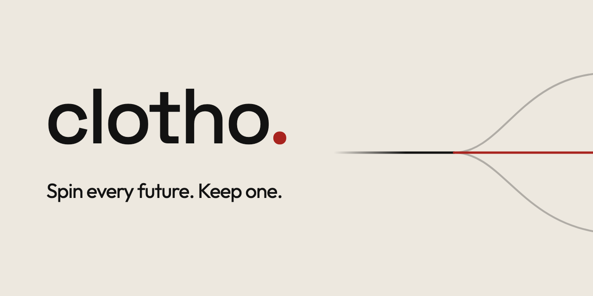
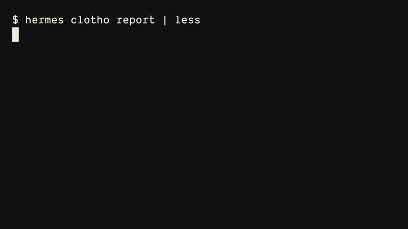

# Clotho for Hermes Agent

**Spin every future. Keep one.**

In Greek myth the three Fates spin, measure and cut the thread of every life. Nous named its RL framework
Atropos, the Fate who cuts. Clotho is her sister: she spins. This plugin spins every possible future of an
agent task (rehearsal + Forks), lets you measure them, and keeps only the one you choose.

What it proves (numbers: [docs/EVAL.md](docs/EVAL.md), 72 task runs over 11 side-effecting tasks; the rest:
the test suite, [tests/README.md](tests/README.md)):

- **0 escapes in 72 task runs**: no request at the HTTP sink, no message at the SMTP sink, no change in the
  workspace or in a sentinel folder outside it during a rehearsal.
- **Fails closed**: a fault injected into the plugin blocks the call; the real tool does not run.
- **The shell actually runs in a sandbox**: inside a copy-on-write clone under macOS `sandbox-exec`, with no
  network and no writes outside it.
- **Apply with 0 model calls and drift checks**: 0 model calls during Apply (counted four ways); sink, SMTP
  and files exact after Apply 72/72; a file edited by hand stopped Apply, nothing changed, 14/14.
- **Forks compares full effect ledgers across models**: one task on several models, every effect side by side.
- **Try it**, no API key, about 10 s: `hermes clotho demo`



## What it does

Rehearse any Hermes task, see every effect it would have, untick what you don't want, then apply.
Apply replays exactly the effects you kept, with no model calls.

```
hermes clotho run "tidy this folder and post a summary to the team webhook"
hermes clotho report            # numbered checkboxes, diffs, IRREVERSIBLE / CAN'T PREVIEW badges
hermes clotho apply --except 3  # replay the rest for real, drift-checked, 0 model calls
```

Inside a chat session: `/clotho on`, then work as usual, `/clotho report`, `/clotho off`.

## Install

```
hermes plugins install NicWeinbrecht/hermes-clotho --enable
```

Needs Hermes Agent 0.23.0 or newer. Shell previews need macOS (`sandbox-exec`); elsewhere shell commands are
captured without a preview. To try it without an API key: `hermes clotho demo` (see [Demo](#demo)).

## Measured

**Nothing escaped, and Apply landed exactly what was ticked.** 72 task runs over 11 side-effecting tasks
(webhooks, email, chat posts, file clean-ups, cron jobs, subagents, memory and skills), driven by a scripted
agent, `deepseek-v4-flash`, `deepseek-v4-pro` and Claude, every run measured at a local HTTP sink, a local SMTP
sink and by hashing the workspace and a folder outside it:

| | result |
|---|---|
| requests, emails or workspace changes that got out during a rehearsal | 0 |
| Apply landed exactly the ticked effects (sink, SMTP, files) | 72/72 |
| model calls during Apply (receipt, scripted endpoint, proxy trap, sandbox log) | 0 |
| a file edited by hand between rehearsal and Apply stopped it, nothing changed | 14/14 |
| Apply wall time, median (`deepseek-v4-flash`, Hermes start included) | 1.5 s |
| runs that passed every check | 69/72 |

The three misses are the model, not a leak: two runs captured extra calls the model really made (a docs fetch
and `hermes cron --help`), and one model said it created a skill it never tried to create; the ledger showed
the truth. One Hermes housekeeping file (`cron/dispatch_held.json`, written by an idle gateway's cron ticker) is
counted as a state change and explained. Method, controls (positive controls for every instrument, 8 of 8
deliberately wrong ground truths caught), per-task tables, costs and limits: [docs/EVAL.md](docs/EVAL.md).
Raw numbers: `eval/results/*/results.json` and `headline.json`; the harness is in `eval/`.

The test suite drives Hermes' real agent loop with scripted tool calls (no model, nothing leaves the machine).
Its escape tests make one call per tool class (reads, file writes inside and outside the workspace, shell
commands that write outside, hard-link out, run in the background or call `osascript`, `execute_code`, plugin
sends, unknown tools, `web_extract`, memory, skills, subagents, symlink tricks, multi-file patches) and check
that the workspace, a sentinel folder and Hermes' memory, skills and cron folders hash the same afterwards and
that the sink got nothing (`tests/test_rehearsal.py` `T2Escape`, `tests/test_capture_escape.py`). A fault
injected into the plugin blocks every call (`T3FailClosed`). How to run it:
`tests/README.md`.

## What happens during a rehearsal

Read-only tools run for real: file reads and searches, skills, session search, `web_search` (so a search
reaches its provider and may be metered), clarify, todo. Page fetches (`web_extract`, `vision_analyze` and
similar) are held, because a fetch can trigger a webhook. Everything else is held:

- File writes land in a copy-on-write clone of your workspace. A write aimed through a symlink is resolved
  first, the way the OS would resolve it, and recorded at the real target with a `VIA SYMLINK` badge that
  also names the path the agent used. A multi-file patch has every file header mapped the same way.
- Shell commands run inside that clone in a macOS sandbox with no network and no writes outside it. Their
  `HOME` is a copy-on-write mirror of your home: a write there (say `mv old.zip ~/.Trash/`) stays in the mirror
  and shows up as an `OUTSIDE WORKSPACE` effect, ticked like any file effect, so Apply would make it in your
  real home. A write to an absolute path into your real home is blocked.
  When a command returns, its process group is killed, and so is a child that started its own session
  (the Disclosure names the one case this misses).
- `execute_code` runs in the same sandbox. Every call gets a row with its code; code that names a network
  module is shown as one it could not preview.
- Messages, web requests, other plugins' tools, cron changes and memory writes are captured instead of sent.
  The agent gets an honest result for each captured call and carries on:
  `[clotho] captured: <what it would do> - not executed. This is a rehearsal: the effect is recorded for review
  and happens only if the user applies it. Any reply is unknown during the rehearsal. Continue the task as if it
  succeeded.`
- Hermes' background memory and skill review can run during `hermes clotho run`. It calls the model, so it
  spends tokens; its memory or skill writes are captured like any other and labelled `BACKGROUND REVIEW`.
- A write Hermes itself refuses (for example overwriting a file the agent has not read) changes nothing, live
  or here, and still gets a `BLOCKED` row, so a report or a fork comparison shows the attempt.

## The report

```
Clotho  r-20261110-064852-f4ca
task  In this folder: read notes.md, write a three-line
      summary of it to summary.md, delete scratch.tmp, th…
in    /Users/you/projects/team-notes
deepseek/deepseek-v4-flash · 4 model calls · 5 tool calls
$0.0052 · 29.2 s

3 effects · 1 irreversible · 0 happened yet
files 2 · web 1
ticked 3

[x]   1  create summary.md (+3 -0)
         @@ -0,0 +1,3 @@
         +Shipped invoice export and fixed the login time…
         +Two new customers signed.
         +Next up: price page and onboarding email.
[x]   2  run `rm scratch.tmp` (1 file change)
  [x]   3  delete scratch.tmp (+0 -1)
           @@ -1 +0,0 @@
           -temporary
[x]   4  POST http://127.0.0.1:18940/e2e/team
         [IRREVERSIBLE] NETWORK
         POST http://127.0.0.1:18940/e2e/team
         | Shipped invoice export and fixed the login
         |  timeout.
         | Two new customers signed.
         | Next up: price page and onboarding email.
         uses the output of #1

1 file change · 1 delete · 1 web request (irreversible)
0 things happened yet
apply:  hermes clotho apply r-20261110-064852-f4ca
choose: --only 1,2  --except 3  (numbers above)
```

- Every effect is ticked by default, messages and web requests included. Three kinds are unticked and run only
  when you name them with `--only`: tools Clotho does not know, held fetches (`web_extract`,
  `vision_analyze` and similar), and commands it could not preview (they needed the network, wrote outside the
  workspace, read a secret or started a background process).
- A single plain `curl` or `wget` call is shown as a web request (method, URL, headers, body) and is ticked like
  any other effect; apply re-runs that exact command. One that saves to or reads from a file (`-o`, `-O`,
  `-T`, `-F field=@file`, a config or cookie file) is shown as a command it could not preview instead.
- A command it could not preview shows what it was seen doing in the sandbox before those changes were thrown
  away (`would delete 11 files`); a blocked call shows what it tried to touch and why it was stopped.
- Many similar effects collapse into one line with their number range (`2-215  move 214 files`); `--expand`
  lists each one. The ranges are the numbers `--only` and `--except` take.
- Lines stay within 58 columns (`--width N` changes that, `--width 0` uses the terminal's width). Colour is
  used only on a terminal, never when `NO_COLOR` is set. `--json` prints the ledger and the default selection.
- On a terminal the IRREVERSIBLE badge is `✂ IRREVERSIBLE` in reverse video; without colour it reads
  `[IRREVERSIBLE]`. The only colour is red, and it marks only the thread you keep: the applied timeline in a
  fork comparison (with `● keep`; the others are dimmed) and the `0 model calls` of an apply receipt.
- Dependencies are shown under the effect that uses them. "uses the output of #1" is certain (the same file,
  or the command names the file); "may use the output of #1 (guess: …)" is a guess from file contents, folder
  listings or what the agent read in between. Only certain dependencies stop an apply.

## Apply

`hermes clotho apply [ID] [--only 1,2,5-9] [--except 3] [--dry-run] [--force] [--json]`

With no ID, `report` and `apply` take the newest rehearsal in this Hermes home, whatever the current folder. When
that one is a fork timeline or a cron run, `apply` stops (exit 3), changes nothing and lists the ids to name.

1. It checks everything before it changes anything. If a file changed since the rehearsal, or a folder on an
   effect's path has since been replaced by a symlink, it stops and names the file (exit 4); each write checks
   the folder again just before it lands. If a ticked effect certainly depends on an unticked one, it stops and
   names both (exit 5); tick the dependency too, untick the dependent, or pass `--force`. A guessed dependency
   only warns: the receipt lists it as a guess and the apply goes on.
2. File effects are written byte for byte from the rehearsed content. Messages and web requests go through
   Hermes' real tools with the stored arguments, so other plugins' hooks still see them.
3. It records each effect as it goes. If something fails, the receipt lists what was applied, what failed and
   why, and what was not attempted (exit 1). Applying again never re-sends what was already sent. A failed web
   request is retried only when its exit code shows it never left the machine; one that may have reached the
   server, or that was cut off mid-send, is held until you name it with `--only`.
4. The receipt ends with `applied 4/4 · skipped 0 · 0 model calls · 0.4 s`.

Exit codes: 0 applied, 1 failed or incomplete, 2 no such rehearsal or effect, 3 refused (inside a
rehearsal, or no ID for a fork timeline or cron run), 4 drift, 5 dependency.

## Forks

A rehearsal has no side effects, so the same task can be run several ways at once and the outcomes compared
before anything happens. Forks compares the full effect ledgers, including captured messages and web requests,
and applies the chosen one with 0 model calls.

```
hermes clotho fork "My disk is nearly full; clean up this folder" --models pro,kimi,flash
hermes clotho fork "Clean up this folder" --variants variants.yaml   # one model, different instructions
hermes clotho compare                       # the last fork again; --json, --expand
hermes clotho apply f-20261110-101812-101f/claude-sonnet
```

- Each timeline is its own `hermes clotho run` process, all started at once, each with its own rehearsal
  id, clone and ledger. `--models` takes `[name=]model[@provider]`. The aliases `flash`, `pro` and `kimi` are
  `deepseek/deepseek-v4-flash`, `deepseek/deepseek-v4-pro` and `moonshotai/kimi-k2.6` on OpenRouter; `claude`
  is sonnet on the Claude subscription. A model without `@provider` gets the provider Hermes would pick for
  it in your home, or OpenRouter when that one has no credentials there (in a home with no default provider,
  Hermes sends `moonshotai/kimi-k2.6` to NVIDIA), and the fork prints which rule it used. A variants file lists a `name` and either `instructions` (added after the task) or `prompt`
  (replaces it) per timeline, with an optional `model`:

  ```
  model: deepseek/deepseek-v4-flash
  variants:
    - name: tidy
      instructions: Tidy it up.
    - name: disk-full
      instructions: My disk is nearly full; keep only what I'd actually want.
  ```
- Spend: a fork of N timelines runs N model sessions at once, so it costs about N times one run. Each timeline
  may make `--max-calls` model calls (default 25). A call over the cap is answered
  with a "stop now" reply and never reaches the provider. At most one timeline may use the Claude-subscription
  provider; its cap is `--max-plan-calls` (default 10), plus Hermes' own title call.
- A model that cannot drive the tool loop (for example a provider answering "No endpoints found that support
  tool use") is dropped and named in the output; it is never replaced by a made-up timeline. A timeline that
  fails is shown with its reason and left out of the comparison. Timelines that get in each other's way (a
  locked database, a rate limit) run again one after another, and the output says so; `--sequential` runs
  every timeline that way.
- The comparison shows one block per timeline (effects by class, the IRREVERSIBLE count, deletes and moves,
  model calls, wall time, cost), then the differences between the ledgers in words. From a real fork on a
  cluttered Downloads folder:

  ```
  not in claude-sonnet: delete 10 files in Downloads/:
    Q3_report.xlsx, boarding-pass-KUL-SIN.pdf,
    invoice_2025_03.pdf +7
  only in claude-sonnet: delete 6 files in Downloads/:
    Q3_report (2).xlsx, boarding-pass-KUL-SIN (1).pdf,
    invoice_2025_03 (2).pdf +3
  only in kimi-k2.6: delete 3 files in Downloads/:
    apartment_inventory_photos.zip,
    old_backup_2019.tar.gz, presentation_draft.key
  ```
- `apply <fork>/<timeline>` is the normal Apply of that timeline's rehearsal: drift-checked, 0 model calls.
  The other timelines never touched your folder, and nothing of theirs is applied. Applying a second
  timeline of the same fork is refused (it would mix two futures); apply its rehearsal id if you mean it.
- Outcomes vary from run to run: on the same folder, prompt and model, deepseek-v4-flash deleted 13 files in
  one fork and 45 in another. A fork shows a few real outcomes side by side; it is not a benchmark.

## Demo

```
hermes clotho demo                     # about 10 s on an Apple-silicon Mac; no API key, no network
hermes clotho demo --apply kimi-k2.6   # apply another timeline instead
```

One command shows a whole fork: a seeded Downloads folder that is "nearly full" (99 small fake files, 10 of
them precious, and the model is not told which), three timelines at once, the comparison, Apply of one
timeline, then what a local sink received and what the folder looks like afterwards.

The model turns are a recording, and the screen says so before anything else. They come from one real fork of
this task on 2026-11-10: `deepseek/deepseek-v4-pro` and `moonshotai/kimi-k2.6` on OpenRouter, and Claude
sonnet on the Claude subscription (it stopped at its cap of 5 calls). They ship in `demo/recordings/` with
neutral paths (`/Users/you/...`), which the demo maps onto its temp folder. Each recorded answer is played back
in place of the provider; everything else runs for real: the capture layer, the sandboxed shell, the ledgers,
the comparison and Apply. The demo also checks that every tool result matches the recording (dates, sizes and
ids aside) and prints the count.

What the recorded fork did, as the demo shows it:

```
deepseek-v4-pro   deletes 29 files · 20 of 99 originals gone for good
                  precious lost: resume_v3_final.docx
kimi-k2.6         deletes 51 files · 42 of 99 originals gone for good
                  precious lost: resume_v3_final.docx
claude-sonnet     deletes 32 files · 0 of 99 originals gone for good · 23 moved to the Trash
                  precious lost: none
```

By default the demo applies the timeline that loses no precious file. Its "Trash" is the demo's own home
folder; nothing outside the temp folder is touched.

Nothing leaves the machine while it runs, and the last block of the output says how that was checked:

- every Python process of the demo runs with a network guard (an audit hook installed before Hermes is
  imported) that refuses and logs any connection or name lookup other than 127.0.0.1, ::1 and localhost;
- `HTTP_PROXY`/`HTTPS_PROXY` point at a local trap that logs every connection it gets;
- the model endpoint of the demo's Hermes home is a local stand-in that logs every request. Hermes asks it a
  few metadata questions (`/api/tags`, `/v1/models`), which it answers 404; a model call there would mean the
  replay failed;
- shell commands run in the rehearsal sandbox, which has no network;
- each check is tested first: the guard must catch a test connection in every process, the trap a test request.

The demo runs in a throwaway Hermes home inside a temp folder (Hermes' runtime is cloned copy-on-write from
your home; no `.env`, no keys, title generation off) and leaves that folder in place so you can look at the
ledgers. It needs macOS, like the shell preview. `--seed DIR` writes just the seeded folder;
`--record OUT --models ...` records new turns from live models in the current folder (that spends real model
calls).

## Cron

Rehearse a scheduled job before you let it run unattended:

```
hermes clotho cron                          # list the jobs
hermes clotho cron daily-digest --runs 3    # three runs, one after another
```

Each run is its own rehearsal, with its own id, ledger and report, so you can review and apply any one
of them. The job itself is left alone: its schedule, next and last run, run history, output documents and
notepad are not written, and a paused job stays paused (you can rehearse it before you resume it). The
result is not delivered; the report says where it would have gone and shows the text.

```
Clotho cron · live-digest (a920d43397ab)
2 runs: 1 identical, 1 differs: +1 web request, -3
commands, 1 file change with other content
run 1  r-20261110-101810-b6be  4 effects (baseline)
run 2  r-20261110-101849-3cec  +1 web request, -3
commands, 1 file change with other content
delivery: held on every run (the job delivers to telegram)
job state: untouched (schedule, history, outputs); next
run 2026-11-11T09:00:00+08:00
```

- The prompt is the one Hermes builds for a scheduled run of the job: the cron instructions, the run time,
  its skills, notepad, upstream job output and script output. The run gets the toolsets a cron run gets.
- A pre-run script runs inside the same macOS sandbox as shell commands, in the rehearsal's copy of the
  workspace, and its output goes into the prompt. If the script needs the network, writes a file or does
  anything else the sandbox stops, the run stops before the model is called and says why, and the later
  runs are not started. Without the sandbox (not macOS), jobs with a script are refused.
- Script-only jobs (`--no-agent`), monitor jobs and jobs that pin their own `base_url` are refused with
  the reason: each of them does something before the agent starts that cannot be held.
- It rehearses in the job's workdir, else the current folder (`--workspace` picks another).
- Each run's report is printed and saved, with a roll-up, in `<Hermes home>/plugin-data/clotho/
  cron-runs/<batch>/` (`run-1.report.txt`, `rollup.txt`, `batch.json`). The roll-up compares the runs'
  effects; the baseline is the most common set. `hermes clotho report <id>` and `apply <id>` work on
  every run.
- It is a command of its own because Hermes does not let a plugin add a flag to `hermes cron`, and reports
  are files because a plugin cannot post a message from inside a cron run.
- A rehearsal of a job runs as a one-shot, not inside the gateway's scheduler, so it never shows up in
  `hermes cron runs`, and Hermes' background memory and skill review can run during it (a real cron run
  skips that review).

## Chat sessions

`/clotho report` answers in the chat with the report as plain text. See the Disclosure for what session
mode can and cannot cover.

## What it cannot do

The Disclosure in `plugin.yaml` lists it in full. The short version:

- Replies to captured messages and responses to captured web requests are unknown, so the agent carries on as
  if they succeeded, and its final text may say things happened that did not. The report is the truth.
- Commands that need the network, write outside the workspace, read a secret or start a background process
  are captured without a preview; they run only if you name them with `--only`.
- Shell previews and the demo need macOS (`sandbox-exec` and APFS clones). On Linux, shell commands are
  captured without a preview; that path was not measured.
- Memory writes and other calls that need the agent loop are shown but cannot be applied in this version.
- `/clotho on` keeps its state in the gateway's memory: a gateway restart or a failed plugin reload ends the
  rehearsal, and later calls run for real.
- Apply runs in a non-interactive terminal, where Hermes auto-approves its own dangerous-command prompt, so your
  tick is the approval.
- `web_search` runs for real during a rehearsal, so a search reaches its provider and may be metered.

`hermes clotho run` refuses to start the model when a provider can run tools outside Hermes' tool path
(ACP providers, and the Claude subscription provider unless it is version 0.3.4, whose native tools I checked
are off), whether you name it with `--provider`, set it in `HERMES_INFERENCE_PROVIDER` or configured it as
your default. `hermes clotho check --provider NAME` says
what it would decide.

## What this unlocks (an idea, not built)

Nothing in this section exists yet. A rehearsal turns any real task into a safe training environment: the
agent acts on a real workspace with real tools, nothing it does happens, and the effect ledger records exactly
what it would have done. That ledger could be the reward signal for an RL environment framework such as Nous
Research's Atropos: score the effects (the right files changed, the right request sent, nothing irreversible
that was not asked for) instead of the agent's own account of what it did.

## More

- [docs/EVAL.md](docs/EVAL.md): the measurement, its method and every number.
- [docs/RUNTIME_CONTRACT.md](docs/RUNTIME_CONTRACT.md): what Hermes guarantees and what Clotho relies on.
- [docs/TOOL_CLASSES.md](docs/TOOL_CLASSES.md): how each tool is treated during a rehearsal.
- Tests: `tests/run.sh` (see `tests/README.md`). MIT licence (`LICENSE`).
